# datadrift_base_framework

**ddoc** (data doctor) — a plugin-based tool for detecting and
diagnosing data drift in ML systems, and leaving the evidence behind.



```bash
pip install -e packages/ddoc
ddoc diff baseline_data/ todays_data/     # OK / DRIFT / BLIND — exit code = verdict
```

## What is in this repository

```
packages/
├── ddoc/      # Core: the `ddoc` CLI, REST API and browser GUI (pluggy hookspecs + YAML recipes)
└── plugins/   # Plugins, each an independent pip package (vision, text, timeseries, ...)
examples/      # Runnable examples: Docker deployment, CI gate, application integration
```

Three ways to use it:

| Surface | Entry point | Use case |
|---|---|---|
| **CLI** | `ddoc <command>` | scripting, CI, remote/batch execution |
| **REST** | `ddoc serve` | integrate with your own services |
| **GUI** | `ddoc serve`, then open it in a browser | interactive exploration |

## Core ideas

- **The framework is light; plugins carry the weight.** `ddoc` core defines
  [pluggy hookspecs](packages/ddoc/ddoc/plugins/hookspecs.py)
  (`drift_detect`, `eda_run`, `report_render`, `export_drift_report`, ...).
  Adding a new detector means writing a plugin — zero framework changes.
- **An honest verdict.** `ddoc diff` answers `OK`, `DRIFT` or `BLIND` —
  "cannot judge" is a first-class answer rather than a silent OK.
- **Recipes.** A YAML DSL (`ddoc recipe run <file>`) chains fetch → analyze →
  report → export steps with variable substitution, so an entire drift-check
  pipeline is a reviewable text file.
- **Loose coupling to applications.** ddoc reads data through `ddoc fetch`
  and ships drift reports as a stable JSON envelope through `ddoc export`
  (file or HTTP) — no shared Python dependency in either direction.

## Quick start

```bash
pip install -e packages/ddoc                              # core CLI
pip install -e packages/plugins/ddoc-plugin-categorical   # add a domain plugin

ddoc examples generate categorical --out /tmp/d --scenario shifted
ddoc diff /tmp/d/ref /tmp/d/cur                           # DRIFT, exit code 1
ddoc diff /tmp/d/ref /tmp/d/cur --report note.html
ddoc serve                                                # REST API + GUI on http://127.0.0.1:8765
```

More in the [ddoc README](packages/ddoc/README.md) and its [docs](packages/ddoc/docs/).

## In-tree plugins

`vision` (image EDA / embedding drift) · `text` · `timeseries` · `audio` ·
`categorical` (JS-divergence on count dicts) · `tabular` · `evidently`
(third-party integration)

Each plugin is an independent pip package registered through the
`ddoc` entry-point group. `packages/plugins/ddoc-full` is a meta-package that
installs the common set.

## Use it as a CI data gate

`ddoc diff`'s exit code carries the verdict (0 = OK, 1 = DRIFT,
2 = BLIND), so it drops straight into CI — a linter for data:

```yaml
- uses: keti-datadrift/datadrift_base_framework@main
  with:
    ref: data/baseline
    cur: data/incoming
    report: drift_note.html   # self-contained evidence report
- uses: actions/upload-artifact@v4
  if: failure()
  with: { name: drift-note, path: drift_note.html }
```

The action installs the ddoc core, which judges CSV files and folders
on its own; see [examples/ci-gate](examples/ci-gate/) for other data
and for CI systems other than GitHub Actions.

Our own [CI](.github/workflows/ci.yml) dogfoods this on the
[Drift Zoo](packages/ddoc/zoo/) — a gallery of classic drift
patterns (regime shift, creeping degradation, and a rhythm-not-drift
trap case that must stay **OK**), each reproducible in one command and
pinned as a regression test.

## Examples

- [`examples/serve`](examples/serve/) — `ddoc serve` in Docker Compose
- [`examples/ci-gate`](examples/ci-gate/) — drift gate for GitHub Actions or any CI
- [`examples/app-integration`](examples/app-integration/) — `fetch` → `diff` → `export` to an application endpoint

## License

Apache License 2.0 — see [LICENSE](LICENSE).
Vendored third-party code retains its original license
(e.g. OpenAI CLIP under MIT, see
`packages/plugins/ddoc-plugin-vision/ddoc_plugin_vision/clip/LICENSE`).
