# ddoc — the data doctor for drift detection

> Diagnose data drift across modalities. CLI · REST · GUI in one wheel.

**ddoc** (data doctor) 은 데이터의 분포 변화를 *진단* 하는 도구입니다.
멀티모달 (vision / text / timeseries / audio / categorical / tabular)
drift detection + EDA + report rendering 을 단일 CLI / REST facade /
vanilla HTML GUI 로 묶어 ML 모델이 보는 데이터의 상태를 일관되게 점검합니다.

## ✨ 주요 기능

- 🩺 **한 줄 판정**: `ddoc diff` — `OK` / `DRIFT` / `BLIND`, exit code 가 곧 판정
- 🔬 **분석**: 플러그인 기반 drift 감지 및 EDA (`ddoc analyze drift|eda`)
- 📝 **리포트와 내보내기**: HTML / PDF / Markdown 리포트, file / HTTP export
- 🧾 **레시피**: fetch → analyze → report → export 를 YAML 한 파일로
- 🌐 **REST + GUI**: `ddoc serve` 로 모든 명령을 HTTP 와 브라우저에서
- 🔌 **플러그인 구조**: 새 검출기는 플러그인으로 — 프레임워크 수정 없음

## 🚀 빠른 시작

### 설치

이 저장소에서 설치 (저장소 루트 기준):

```bash
pip install -e ddoc                              # 가벼운 코어 — CSV 는 플러그인 없이 판정
pip install -e plugins/ddoc-plugin-categorical   # 필요한 modality 플러그인을 추가
```

플러그인은 각각 독립 패키지입니다 (`plugins/ddoc-plugin-*`).
`plugins/ddoc-full` 은 기본 플러그인 묶음을 한 번에 설치하는 메타 패키지입니다.



### 10 초 quick start — `ddoc diff`

가지고 있는 데이터 두 벌을 그대로 가리키면 됩니다. 설정 없음:

```bash
ddoc diff baseline_data/ todays_data/
```

```
⚠ DRIFT — severity: high · score 0.27 (threshold 0.15)
   가장 변한 속성: price 0.42 · color 0.18
   ⤷ 처방: 'price' 축의 최근 샘플을 재계측/재라벨 후보로 검토
```

- 입력 모달리티 자동 감지 — **생 CSV 는 플러그인 없이도** 내장 비교기로 동작
- 판정은 `OK` / `DRIFT` / **`BLIND`** (판정불가를 정직하게 셋째 답으로)
- **exit code = 판정** (`0`/`1`/`2`) → CI 에서 그대로 데이터 게이트로

```bash
ddoc diff jan.csv aug.csv --json                # 스크립트/CI: JSON 한 객체
ddoc diff jan.csv aug.csv --report note.html    # 소견서: 판정+근거 분포+처방 1페이지 HTML
```

고전 드리프트 패턴 갤러리(레짐 전환·점진 열화·주기 함정)는
[Drift Zoo](zoo/) — 케이스마다 한 명령 재현 + 회귀 테스트.

toy 데이터로 바로 체험하려면:

```bash
ddoc examples generate categorical --out /tmp/d --scenario shifted
ddoc diff /tmp/d/ref /tmp/d/cur
```

정밀 제어(detector 선택·fusion)는 저수준 명령 `ddoc analyze drift` 로:

```bash
ddoc analyze drift --data-path-ref /tmp/d/ref --data-path-cur /tmp/d/cur --json --quiet
```

→ `overall_score: 0.11` 같은 envelope 한 줄로 떨어집니다.

5 modality 의 toy 데이터 (`timeseries / audio / text / vision / categorical`),
2 scenario (`shifted / identical`) 를 제공합니다. 자세한 내용은
[toy-data 튜토리얼](docs/tutorial/toy-data.md). 본인 데이터로 옮길 때는 같은
dataset layout (modality 별 `ddoc.yaml` + 데이터 파일) 만 따르면 그대로
`ddoc analyze drift --data-path-ref X --data-path-cur Y` 가 동작합니다.

`--detector` 옵션을 골라야 할 때는 [detector cookbook](docs/tutorial/detectors.md)
참고 — modality 별 strategy 선택과 drift severity 임계값.

## 🧰 명령 한눈에 보기

| 명령 | 하는 일 |
|---|---|
| `ddoc diff <ref> <cur>` | 한 줄 판정 (exit 0/1/2), `--report` 로 HTML 소견서 |
| `ddoc analyze drift` / `eda` | 플러그인 기반 저수준 분석, `--json` envelope |
| `ddoc report render` | drift / EDA envelope → HTML · PDF · Markdown |
| `ddoc export drift-report` | drift 결과를 file / HTTP 로 전송 |
| `ddoc fetch <uri>` | file / s3 / gs / http 데이터를 로컬로 가져오기 |
| `ddoc recipe run <file>` | 여러 단계를 YAML 로 묶어 실행 |
| `ddoc serve` | REST API + 브라우저 GUI |
| `ddoc plugin list` / `detectors` | 설치된 플러그인과 검출기 확인 |
| `ddoc examples generate` | toy 데이터셋 생성 |

전체 옵션은 [명령어 레퍼런스](docs/reference/commands.md) 참고.

## 📚 문서

- **[빠른 시작](docs/tutorial/quick-start.md)** · **[핵심 개념](docs/tutorial/concepts.md)** · **[설치](docs/tutorial/installation.md)**
- **[toy 데이터](docs/tutorial/toy-data.md)** · **[detector cookbook](docs/tutorial/detectors.md)** · **[데이터 분석](docs/guides/analysis.md)**
- **[레시피](docs/tutorial/recipe.md)** · **[REST / GUI](docs/tutorial/serve.md)** · **[배포](docs/tutorial/deploy.md)**
- **[명령어 레퍼런스](docs/reference/commands.md)**

전체 문서는 [docs/](docs/) 디렉토리에서 확인하세요.
[변경 이력](docs/changelog.md) | [릴리스 노트](docs/releases/)

## 🔗 애플리케이션과의 연동

ddoc 는 모니터링 대상 애플리케이션과 Python 의존성을 공유하지 않습니다.
데이터는 `ddoc fetch` 로 들여오고, drift 결과는 안정된 JSON envelope 로
`ddoc export` 가 file 또는 HTTP 로 내보냅니다.

다른 서비스에서는 ddoc 를 *Python library* 로 import 하는 대신
`ddoc analyze drift|eda --json` 을 **subprocess 로 호출** 하거나
`ddoc serve` 의 REST API 를 쓰면 됩니다. 저장소 루트의
[examples/](../examples/) 에 연동 예제가 있습니다.

## 🤝 기여

이슈와 Pull Request 를 환영합니다.

## 📄 라이선스

Apache License 2.0 — [LICENSE](LICENSE) 참조.

## 👥 기여자

- JPark @ KETI
- Ethicsense @ KETI
